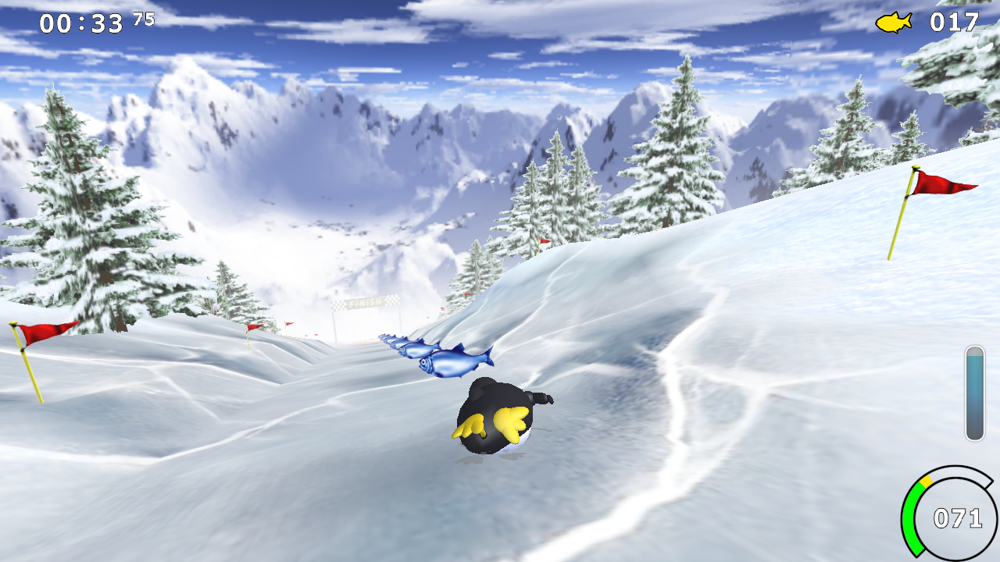

# Extreme Tux Racer for Trimui

A port of Extreme Tux Racer 0.6.99 (SDL 1.2 + desktop OpenGL) to the Trimui
Smart Pro (tg5040, aarch64, PowerVR GLES2). The game is ported to SDL2 with a
GLES2 context, and [gl4es](https://github.com/ptitSeb/gl4es) is linked in
statically to translate the fixed-function OpenGL calls.



## Status

Tested on one Trimui Smart Pro running the stock Trimui menu (1280x720):
menus, racing, pause and quit work. Not yet verified: audio, other firmwares
(GarlicOS etc.), and other screen sizes such as the Trimui Brick.

## Install

1. Download `ExtremeTuxRacer-trimui.zip` from the releases page.
2. Unzip it onto the root of the SD card. It adds:
   - `Roms/PORTS/Extreme Tux Racer.sh`
   - `Roms/PORTS/ExtremeTuxRacer/` (binary and game data, about 60 MB)
   - `Roms/PORTS/Imgs/Extreme Tux Racer.png`
3. Open the Ports section on the console. If the game is not listed, refresh
   the game list.

The port uses the SDL2, SDL2_image, SDL2_mixer and freetype libraries that ship
with the stock firmware (`/usr/trimui/lib`, `/usr/lib`).

## Controls

| Button             | In a race                               | In menus      |
|--------------------|-----------------------------------------|---------------|
| D-pad / left stick | steer (D-pad up/down also paddle/brake) | navigate      |
| A                  | paddle                                  | confirm       |
| B                  | brake                                   | back          |
| X / Y / R1         | jump (hold to charge)                   | confirm       |
| L1                 | reset Tux                               | next widget   |
| Start              | pause                                   | confirm       |
| Select / Menu      | quit race                               | back / quit   |

## Troubleshooting

The game writes `Roms/PORTS/ExtremeTuxRacer/etr.log` on every run. Create an
empty file named `debug` in that folder to also log gamepad input.
Settings, players and high scores are stored in `ExtremeTuxRacer/config/`.

## Building

```sh
# 1. base toolchain image (Trimui SDK + aarch64 cross compiler)
git clone https://github.com/dimitrovs/trimui-smart-pro-build-system
(cd trimui-smart-pro-build-system && make build)

# 2. port build image, sources
git clone -b trimui https://github.com/dimitrovs/extremetuxracer-sdl
git clone https://github.com/ptitSeb/gl4es
docker build -t trimui-etr-build extremetuxracer-sdl/trimui

# 3. build and package
docker run --rm -u $(id -u):$(id -g) \
  -v $PWD/extremetuxracer-sdl:/work/etr -v $PWD/gl4es:/work/gl4es \
  trimui-etr-build sh -c '/work/etr/trimui/build.sh && /work/etr/trimui/package.sh'
```

The result is `extremetuxracer-sdl/build-trimui/ExtremeTuxRacer-trimui.zip`.

## What changed for the port

- SDL 1.2 -> SDL2 (window/context, events, audio, image loading).
- GLES2 context from SDL2, gl4es initialised on top of it; small GLU
  replacement in `src/glu_compat.cpp`.
- Gamepad buttons translated to the keys the game expects (`src/states.cpp`).
- Texture fonts instead of `glDrawPixels` pixmap fonts.
- Config and data live next to the binary instead of `~/.etr` and a system
  data directory.
- Fixes: out-of-bounds read in the "reset Tux" state, crash on exit.

## Licences

Extreme Tux Racer is GPLv2 (see `COPYING`); this port's source is this
repository. gl4es is MIT licensed. Both licence texts are included in the zip
under `ExtremeTuxRacer/licenses/`.
